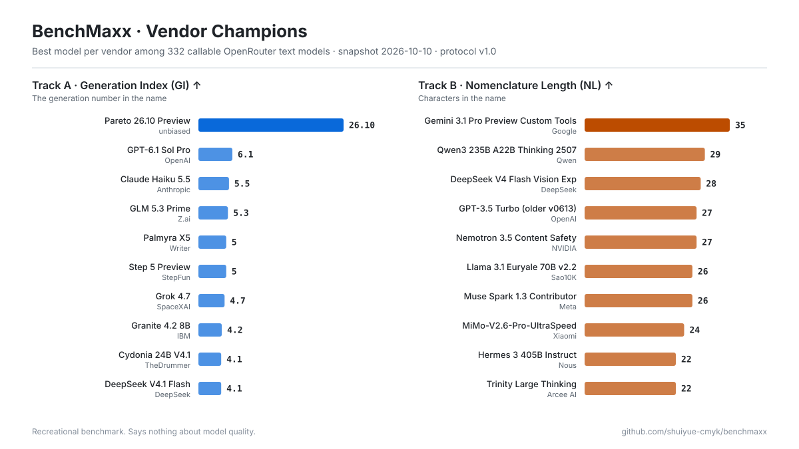
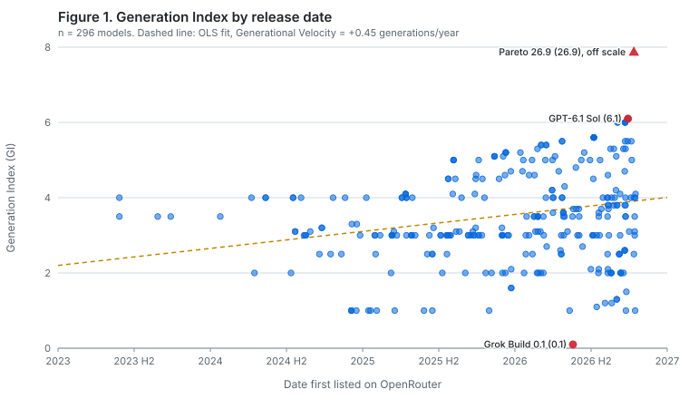
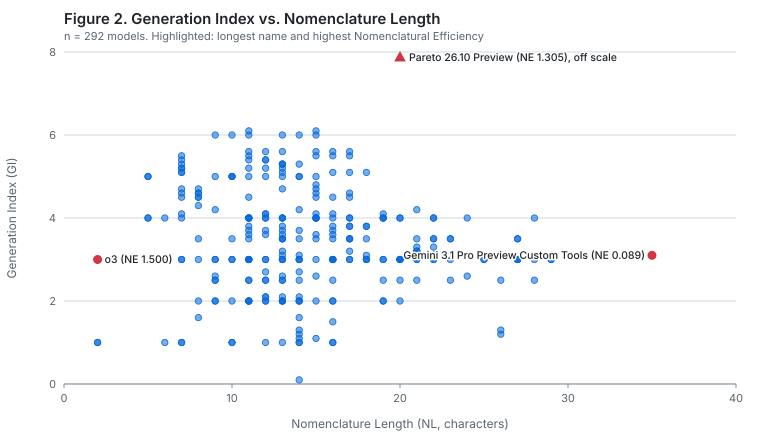

<div align="center">

# BenchMaxx

**以命名为中心的大语言模型评测基准**

*只看模型叫什么，不看它能做什么。*

[English](README.md) · [简体中文](README.zh-CN.md)

[](https://github.com/shuiyue-cmyk/benchmaxx/actions/workflows/tests.yml)


[](LICENSE)

</div>

> [!NOTE]
> BenchMaxx 是一个娱乐性质的基准测试，评测结果与模型能力毫无关系。不过它的方法论是完全认真的。

## 摘要

当前的大模型评测普遍面临数据污染、分数饱和、推理成本高和难以复现这四个问题。**BenchMaxx**
的做法是完全不运行被测模型，从而一次性避开这四个问题。BenchMaxx 对
[OpenRouter](https://openrouter.ai) 上所有可调用的文本模型，从两个相互独立的*命名能力*维度打分：

- **赛道 A：代际指数（Generation Index, GI）**：模型名称里代际数字的大小
  （`GPT-6.1` → 6.1，`Qwen3.8` → 3.8，`Kimi K3` → 3）。
- **赛道 B：名称长度（Nomenclature Length, NL）**：模型名称的字符数。

评分过程完全确定，不需要 API Key，不消耗任何 token，一分钟内跑完。每次评测都会重新生成下方榜单，并存档快照。

## 排行榜

<!-- BENCHMAXX:BEGIN -->
**快照日期：2026-10-10**　·　共评测 **332** 个可调用文本模型（292 个具备代际数字）　·　行业代际膨胀速度 **+0.45 代/年**

#### 赛道 A：代际指数（GI）Top 10

| 名次 | 模型 | 厂商 | 代际指数 GI | 名称长度 NL |
| --: | :-- | :-- | --: | --: |
| 🥇 1 | Pareto 26.10 Preview | unbiased | `26.10` | 20 |
| 🥈 2 | GPT-6.1 Sol | OpenAI | `6.1` | 11 |
| 🥈 2 | GPT-6.1 Sol Pro | OpenAI | `6.1` | 15 |
| 4 | GPT-6 Astra | OpenAI | `6` | 11 |
| 4 | GPT-6 Astra Pro | OpenAI | `6` | 15 |
| 4 | GPT-6 Luna | OpenAI | `6` | 10 |
| 4 | GPT-6 Luna Pro | OpenAI | `6` | 14 |
| 4 | GPT-6 Sol | OpenAI | `6` | 9 |
| 4 | GPT-6 Sol Pro | OpenAI | `6` | 13 |
| 10 | GPT-5.6 Luna | OpenAI | `5.6` | 12 |
| 10 | GPT-5.6 Luna Pro | OpenAI | `5.6` | 16 |
| 10 | GPT-5.6 Sol | OpenAI | `5.6` | 11 |
| 10 | GPT-5.6 Sol Pro | OpenAI | `5.6` | 15 |
| 10 | GPT-5.6 Terra | OpenAI | `5.6` | 13 |
| 10 | GPT-5.6 Terra Pro | OpenAI | `5.6` | 17 |

#### 赛道 B：名称长度（NL）Top 10

| 名次 | 模型 | 厂商 | 名称长度 NL | 代际指数 GI |
| --: | :-- | :-- | --: | --: |
| 🥇 1 | Gemini 3.1 Pro Preview Custom Tools | Google | 35 | `3.1` |
| 🥈 2 | Gemini 3.1 Flash Lite Preview | Google | 29 | `3.1` |
| 🥈 2 | Qwen3 235B A22B Instruct 2507 | Qwen | 29 | `3` |
| 🥈 2 | Qwen3 235B A22B Thinking 2507 | Qwen | 29 | `3` |
| 5 | DeepSeek V4 Flash Vision Exp | DeepSeek | 28 | `4` |
| 5 | Gemini 2.5 Pro Preview 06-05 | Google | 28 | `2.5` |
| 5 | Qwen3 Coder 30B A3B Instruct | Qwen | 28 | `3` |
| 8 | GPT-3.5 Turbo (older v0613) | OpenAI | 27 | `3.5` |
| 8 | Nemotron 3.5 Content Safety | NVIDIA | 27 | `3.5` |
| 8 | Qwen3 30B A3B Instruct 2507 | Qwen | 27 | `3` |
| 8 | Qwen3 Next 80B A3B Instruct | Qwen | 27 | `3` |
| 8 | Qwen3 Next 80B A3B Thinking | Qwen | 27 | `3` |
| 8 | Qwen3 VL 235B A22B Instruct | Qwen | 27 | `3` |

全部模型的完整榜单见 [`results/LEADERBOARD.md`](results/LEADERBOARD.md)
<!-- BENCHMAXX:END -->

<p align="center">
  
</p>

<p align="center">
  
  
</p>

## 主要发现（首次评测，2026-10-10）

1. **日历版本号碾压全场。** *Pareto 26.10 Preview* 以 GI 26.1 夺得赛道 A 冠军，约为亚军
   （*GPT-6.1 Sol*，GI 6.1）的 **4.3 倍**。它的办法是直接用“年.月”当版本号，是古德哈特定律的教科书案例
   （见 [方法论 §8.2](METHODOLOGY.md#82-goodharts-law)）。
2. **Preview Custom Tools。** *Gemini 3.1 Pro Preview Custom Tools* 以 **35 个字符** 夺得赛道 B 冠军，
   亚军是三个并列 29 字符的模型。
3. **两个字符就够了。** *o3* 的命名效率（NE = GI / NL = 1.50）全场最高，两个字符承载了三代。
4. **代际通胀确实存在。** 全行业的版本号以 **每年 +0.45 代** 的速度上涨，阶跃星辰（+2.20/年）和
   SpaceXAI（+2.16/年）涨得最快。
5. **代际倒退也确实存在。** Meta（−1.13/年）和腾讯（−1.29/年）的代际速度为负。Meta 从
   *Llama 4* 换到了 *Muse Spark 1.x*。
6. **小数陷阱。** 按“十进制解释原则”，*Grok 4.20*（GI 4.2）排在前代 *Grok 4.3* 之后。
7. **拒绝编号者。** 332 个模型中有 40 个（12%）名称里没有代际数字，Cohere 和 Perplexity 的 GI 覆盖率均为 0%。

## 方法概览

```
OpenRouter /models ──► 排除别名、路由器、        ──► 合并 :free / :batch ──► 验证至少 1 个
   （458 个 slug）       非文本输出模型（−40）          变体（332 个模型）       在线 endpoint
                                                                                  │
                     ┌────────────────────────────────────────────────────────────┘
                     ▼
         规范名称  "OpenAI: GPT-5.6 Terra Pro (batch)"  ──►  "GPT-5.6 Terra Pro"
                     │
          ┌──────────┴───────────┐
          ▼                      ▼
   GI = 5.6（第一个数字，    NL = 17（Unicode 码点数）
   跳过 27B / 2507 /
   日期 / 8x22B）
```

完整的规范性说明见 **[METHODOLOGY.md](METHODOLOGY.md)**（英文），包括排除标准、提取规则、示例、排名规则和效度威胁。

## 复现结果

需要 Python 3.10 及以上版本，无需安装任何依赖。

```bash
git clone https://github.com/shuiyue-cmyk/benchmaxx.git
```

```bash
python -m benchmaxx
```

程序会拉取最新快照、验证可调用性，并输出：

| 路径 | 内容 |
| :-- | :-- |
| `data/snapshots/YYYY-MM-DD.json` | 原始 API 快照和 endpoint 计数（复现依据） |
| `results/LEADERBOARD.md` | 全部赛道的完整榜单、厂商分析、DNQ 名单 |
| `results/latest.csv` / `latest.json` | 每个模型的得分与排名 |
| `results/figures/*.svg` | 图表（自动适配浅色/深色模式） |

基于历史快照精确重算：

```bash
python -m benchmaxx --snapshot data/snapshots/2026-10-10.json
```

运行一致性测试：

```bash
python -m unittest discover -s tests -t .
```

## 常见问题

**GI 越高越好吗？**
按本基准的定义，是的。按其他任何定义，都不是。

**我喜欢的模型名字里没有数字怎么办？**
它会在赛道 A 被标记为 *未达资格（DNQ）*，但仍参加赛道 B。我们尊重它的选择。

**为什么 `Grok 4.20` 记为 4.2？**
见十进制解释原则（[方法论 §4.3](METHODOLOGY.md#43-decimal-interpretation-principle-dip)）。

**厂商能刷这个榜吗？**
能，改名就行。和其他基准不同，我们公开承认这一点。

**会加赛道 C：连字符密度吗？**
欢迎提 issue。任何协议变更都会提升协议版本号。

## 引用

```bibtex
@misc{benchmaxx2026,
  title        = {BenchMaxx: A Nomenclature-Centric Evaluation of Large Language Models},
  author       = {{BenchMaxx Contributors}},
  year         = {2026},
  howpublished = {\url{https://github.com/shuiyue-cmyk/benchmaxx}},
  note         = {Protocol v1.0}
}
```

## 许可证

[MIT](LICENSE)。模型名称及元数据归各自所有者所有，均取自 OpenRouter 公开 API。本项目与 OpenRouter 及任何模型厂商均无关联。
